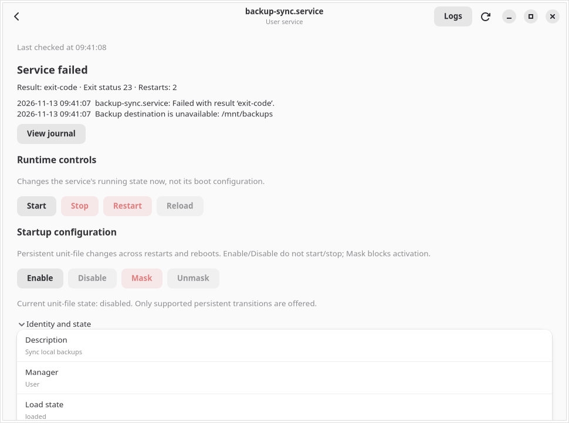

# ServiceForge

**ServiceForge** is a native GNOME application for troubleshooting systemd services on Fedora. Find a failed system or user service, check its exit status, and read the journal for the boot when it failed.



## Install the Fedora preview

Download the RPM for Fedora **44** or **45** from [GitHub Releases](https://github.com/tobiasGuta/ServiceForge/releases). From the download directory, install it with the command for your Fedora version:

```bash
sudo dnf install ./serviceforge-0.1.0-1.fc45.noarch.rpm
```

On Fedora 44, use the package ending in `fc44.noarch.rpm`. Open **ServiceForge** from the GNOME app launcher. Choose **Overview** to find failed services, then open one in the Inspector. Use **View journal** and the **Boot** selector to investigate older failures.

> **Development preview.** Verify administrative actions with a disposable service before relying on them.

## Features in the current development preview

- GTK4 and Libadwaita window using Fedora's system-provided PyGObject bindings.
- Asynchronous discovery of loaded services and installed-but-unloaded unit files from the system or user manager.
- Search, quick filters, clickable column sorting, manual refresh, and optional **Live** monitoring of the selected system/user manager.
- Status icons and counts for active, inactive, and failed loaded services.
- Select a row to open the **Service Inspector**, or click **Inspect**.
- Read authoritative unit and service properties on demand, including unit-file path, PID, restart policy, execution commands, result, and dependencies.
- Clear unavailable values and error/partial-result messages.
- **Overview** page: loaded-service counts, installed-but-unloaded count, direct links to failed services, and an in-session feed of observed systemd manager events.
- **Inspector:** live service properties, a last-checked time, and a failure summary with the result, exit status, restart count, and up to three recent error messages.
- **Logs:** up to 200 readable journal entries from the selected boot, with the current boot selected by default.
- Journal message search, severity filtering, refresh, and an explicit copy action.
- Explicitly confirmed Start, Stop, Restart, and Reload runtime controls when eligible.
- Systemd D-Bus job tracking reports whether a runtime operation completed.
- Existing systemd/Polkit authorization; no root GUI or custom privileged helper.
- **Separate startup configuration controls:** persistent Enable, Disable, Mask and Unmask with no forced file replacement.
- Fresh unit-file state validation before and after each file operation; uncertain outcomes are not reported as verified.
- Typed service-name confirmation for persistent system-wide changes and Mask/Unmask.
- Intentionally conservative restrictions for protected system units, special unit-file states, and masking active units.

The service list merges currently loaded units with installed service unit files, even after systemd unloads stopped services. Unloaded entries show an **unknown** runtime state. Bare templates without an instance are excluded. Overview counts runtime states for loaded services and shows the installed-but-unloaded count separately.

The Inspector uses `GetUnit` for loaded-only units and `LoadUnit` for known installed unit files. `LoadUnit` resolves configuration in systemd's memory without starting the service. It then reads `Unit` and `Service` properties. An unavailable or deleted file results in an actionable refresh message rather than a loop. Unit-file states with no exact match remain `Unknown`, never guessed as `disabled`.

## Run from source on Fedora

```bash
sudo dnf install git python3 python3-gobject gtk4 libadwaita python3-systemd
git clone https://github.com/tobiasGuta/ServiceForge.git
cd ServiceForge
PYTHONPATH=src python3 -m serviceforge
```

From the service table, click **Overview** for the dashboard. To inspect a unit, select it and click **Inspect** (or activate its row), then click **Logs** for journal history.

### Live monitoring

The **Live** button is enabled by default. ServiceForge connects to the selected system/user manager using a **private D-Bus connection** (isolated from the D-Bus client used for management operations). It subscribes to loaded-unit changes, job results, unit-file changes and relevant property notifications. Multiple rapid signals trigger a single debounced refresh after roughly 750 ms. A reconciliation refresh occurs every 90 seconds to repair missed notifications.

Relevant job and property events also refresh the service open in the Inspector. When event subscription is unavailable, the app shows the reason and polls every 45 seconds. Turn Live off to pause automatic refresh. Switching managers clears the previous list while the new scope loads.

The Overview's **Recent manager activity** shows at most 10 of the last 30 signals observed for that manager **during this app session**, not historical logs or an audit trail. Unit loaded/unloaded events describe systemd's memory only, not installed-unit presence or a successful service start. For historical diagnostics, continue using the Logs view. Signals never authorize or perform administrative actions.

To verify Live monitoring with a disposable user unit, follow the [Fedora live-monitoring test guide](docs/live-monitoring-testing.md).

### Experimental service actions

For a safe hands-on test, follow [the disposable user-service test guide](docs/testing.md).

Inside the Inspector, two independent control groups are available:

- **Runtime controls:** Start, Stop, Restart and Reload (the latter only with `Unit.CanReload=true`). Runtime changes affect running state and are tracked with `JobRemoved`.
- **Startup configuration:** Enable, Disable, Mask and Unmask. These change unit-file configuration **persistently** and do not automatically start/stop any service. They require a real installed file, supported file state and fresh revalidation. Masking is offered only to disabled, inactive units. Protected core system units and uncommon file states are deliberately excluded.

Every operation requires confirmation that identifies the target manager. Persistent system-wide changes and Mask/Unmask also require typing the exact unit name. System-manager operations may prompt for Polkit authentication or be denied by local policy.

**For testing, use only disposable services you created**, not NetworkManager, SSH, display management, logind, auditing, or other essential components. The maintainer's screenshots verified user-service Stop, Restart and Start, including a stopped unit being unloaded and later started again. The maintainer has reported that persistent file changes and disposable system-manager authorization tests passed on Fedora. The specific authentication prompt behavior was not independently observed.

Follow [unit-file action testing](docs/unit-file-testing.md) and [system-service Polkit testing](docs/authorization-testing.md). The [runtime testing guide](docs/testing.md) remains available.

The journal viewer uses native `python3-systemd` bindings and includes selected systemd-manager lifecycle messages. The boot selector lists previous boots that are still retained and readable. Journal permissions and missing fields can limit what appears.

Run pure-Python tests:

```bash
python3 -m unittest discover -s tests -v
```

Use a regular user account. Do not run the GUI with `sudo`.

## Project structure

- `src/serviceforge/app.py`: application entry point.
- `src/serviceforge/ui/main_window.py`: native service explorer UI.
- `src/serviceforge/backend/systemd_client.py`: asynchronous Gio D-Bus client.
- `src/serviceforge/backend/live_monitor.py`: private D-Bus signal watcher and bounded refresh fallback.
- `src/serviceforge/models/monitoring.py`: pure signal filtering and in-session event feed.
- `src/serviceforge/backend/normalize.py`: pure-Python normalization of systemd responses.
- `src/serviceforge/models/service.py`: immutable service record.
- `src/serviceforge/models/overview.py`: snapshot counts and failed services.
- `src/serviceforge/models/journal.py`: safe journal formatting/filtering.
- `src/serviceforge/backend/journal_reader.py`: bounded native journald access off the UI thread.
- `src/serviceforge/ui/overview_view.py`: dashboard.
- `src/serviceforge/ui/journal_view.py`: read-only log viewer.
- `tests/`: testable data transformation and invariants.
- `docs/`: architecture, roadmap, and security model.

## Safety and limitations

ServiceForge is not an elevated process. Inspection and journal features are read-only. The new runtime management buttons explicitly request authorized D-Bus operations only after user confirmation. The system manager uses the system bus; the user manager uses the session bus. Error messages may reflect local systemd or D-Bus configuration.

Live refresh, pause and resume, manager switching, and runtime job tracking were checked against a disposable user service on Fedora 45. The additional non-forcing mask edge case is tracked in [Issue #4](https://github.com/tobiasGuta/ServiceForge/issues/4).

## Roadmap

1. Live journal streaming and richer journal matching.
2. Further integration tests for unusual unit-file paths and Polkit policy variants.
3. Accessibility, dependency inspection, and resource accounting.

See [architecture](docs/architecture.md), [roadmap](docs/roadmap.md), and [security model](docs/security-model.md).

## License

Copyright © 2026 Tobias Guta. ServiceForge is free software under [GPL-3.0-or-later](LICENSE). You can use, study, modify, and share it under those terms.
